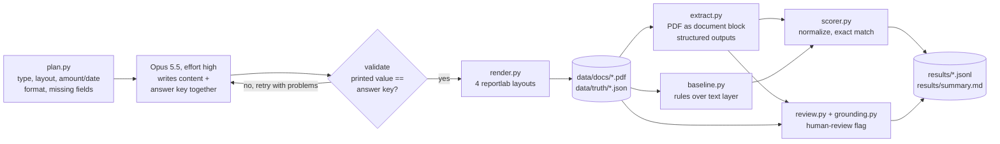

# PolicyLens

Structured extraction from Indian insurance policy and surety bond PDFs, with an eval harness that
measures field-level accuracy, cost and latency across Claude models, a non-LLM baseline, and a
review step that catches the errors model confidence misses.

## Key findings

- **On clean digital documents, the cheapest model is enough.** Haiku 5.5, Sonnet 5.5, Opus 5.5 and
  Fable 5.2 all score 99.5-99.8% field accuracy and their confidence intervals overlap: this data
  cannot rank them. Haiku at low effort costs $0.0009 per document, 1/36th of Opus.
- **The LLM beats rules where it matters.** A rule-based extractor written against half the documents
  gets 76.7% of the unseen half fully right. Haiku gets 96.7%, with no per-layout rules to maintain.
- **Model confidence cannot decide what a person should check.** A 0.80 confidence flag caught 0 of
  12 errors. The most dangerous one, a sum insured read 10x too high, came with confidence 0.97.
- **A deterministic check catches what confidence misses.** Requiring every extracted amount to be
  printed in the document caught both 10x errors and added zero false alarms across 420 extractions, and
  97-100% of deliberately corrupted amounts in a stress test. It needs a text layer, so scanned
  documents are the open problem: a scanned-style test set is built, and evaluating it is next.

```
python -m policylens                 # demo mode: saved results, no API key needed
python -m policylens --doc doc_034   # one document: answer key vs every model's answer
```

## The problem

An insurance brokerage receives policy schedules and surety bonds from many insurers, each with
its own layout, and someone re-keys the same ten facts into a system: who is insured, by whom,
the policy or bond number, the line of business, sum insured, premium, GST, the period of cover,
and, for surety bonds, the beneficiary (obligee). Indian documents add their own traps: amounts
in lakh/crore ("Rs. 12.5 Lakhs", "₹1,87,50,000.00", "INR 1,234,567.00"), day-first dates in half a
dozen formats, an IDV that *is* the sum insured on a motor policy, and decoy amounts (contract
values, stamp duty, total premium including GST) next to the real ones.

The question this project answers is not "can an LLM do this?" but **"which model and setting
should do it, how accurate is it, what does it cost, and can we tell when it is wrong?"**

## Results

60 synthetic documents, 10 fields each, exact match after normalization. Full report with
per-field accuracy, every miss and all the tables below: [`results/summary.md`](results/summary.md).

| Extractor | Effort | Field accuracy | All 10 fields correct | 95% CI | Cost / doc | Mean latency | p95 latency |
|---|---|---|---|---|---|---|---|
| claude-haiku-5-5 | low | 99.7% | 96.7% | 89-99% | $0.0009 | 3.3s | 7.1s |
| claude-sonnet-5-5 | low | 99.5% | 95.0% | 86-98% | $0.0164 | 3.0s | 3.5s |
| claude-opus-5-5 | low | 99.8% | 98.3% | 91-100% | $0.0328 | 3.4s | 3.9s |
| claude-opus-5-5 | medium | 99.8% | 98.3% | 91-100% | $0.0329 | 3.6s | 4.8s |
| claude-fable-5-2 | low | 99.8% | 98.3% | 91-100% | $0.0657 | 5.6s | 11.2s |

The interval is a Wilson score interval on "all 10 fields correct". Haiku was run three times:
all three runs produced identical values for all 600 document-fields.

**Against a non-LLM baseline**, on the 30 documents the baseline's rules were never tuned on:

| Extractor | Field accuracy | All 10 fields correct | 95% CI | Cost / doc |
|---|---|---|---|---|
| Rules over the PDF text (`policylens/baseline.py`) | 95.7% | 76.7% | 59-88% | $0 |
| claude-haiku-5-5, low effort | 99.7% | 96.7% | 83-99% | $0.0009 |
| claude-opus-5-5, low effort | 99.7% | 96.7% | 83-99% | $0.0328 |

The baseline scored 90% on the 30 documents its rules were written against and 77% on the 30 it
had not seen. That gap is the maintenance cost of rules: every new insurer layout needs new ones.

**Reading the tables honestly:** with 600 fields per row, one error moves field accuracy by 0.17
points. The best and worst model rows are two errors apart and every model interval overlaps. These
numbers say "all of these models extract clean digital documents very well", not "model X beats
model Y". What differs is *which* errors each model made (below) and cost, which spans 70x.

**What I would ship from this evidence:** Haiku 5.5 at low effort ($0.05 per 60 documents) with the
amount-grounding check routing any unprinted amount to a person. Neither medium effort nor Fable
5.2 bought anything on this task. Before trusting it on real intake, run the scanned set (below).

### What demo mode shows

```
$ python -m policylens --doc doc_034
[claude-sonnet-5-5:low]  review flag: amount_not_in_document:sum_insured
  ok   insured_name           Periyar Valley Medical Charitable Trust     conf 0.99
  ok   policy_or_bond_number  AGI/32/FIR/BLUS/2025/004817                 conf 0.98
  MISS sum_insured            4850000000.0                                conf 0.97
  ok   premium                194000.0                                    conf 0.98
  ...
```

The PDF says "Rs. 48,50,00,000/- (Rupees Forty Eight Crore Fifty Lakh Only)". The model reported
₹485 crore at 0.97 confidence; the grounding check flags it because that number is printed nowhere.

## How it works



1. **Plan** (`policylens/generation/plan.py`). Python, not the model, decides what varies:
   document type (23 surety bonds, 8 fire, 8 motor, 7 marine, 7 health, 7 liability), layout
   (certificate, schedule table, two-column, prose bond deed), amount format (5 styles), date
   format (6 styles) and which fields are absent (beneficiary 37, GST 19, premium 9, policy number 3).
   Seeded, so the dataset is reproducible.
2. **Generate** (`scripts/generate_dataset.py`). `claude-opus-5-5` at high effort writes each
   document's content *and* its answer key in one structured-output call, including the exact
   string printed for every value. All parties and insurers are fictional.
3. **Validate** (`policylens/generation/spec.py`). Every printed value is run through the same
   normalizers the scorer uses and must equal the answer key; GST must be 18% of premium; dates
   must be ordered; omitted fields must be absent; in the prose layout every value must appear
   verbatim in the text. Failures are sent back to the model with the list of problems (up to 3
   attempts). All 60 passed on the first attempt. Cost: $4.22.
4. **Extract** (`policylens/extract.py`). The PDF goes in as a base64 `document` block;
   `messages.parse` with a Pydantic schema returns the ten fields plus a confidence per field.
   Model and effort are parameters; the served model is recorded on every row.
5. **Score** (`policylens/scorer.py`, `policylens/normalize.py`). Amounts to paise (lakh/crore,
   Indian and Western grouping, "/-", amounts in words in parentheses), dates day-first to ISO,
   names case/punctuation/"Pvt"/"Ltd"/"M/s"-insensitive, policy numbers whitespace-insensitive
   but separator-sensitive. Null vs null is correct; null vs value is wrong either way.
6. **Flag** (`policylens/review.py`, `policylens/grounding.py`). Routes a document to a person if
   any confidence is below 0.80, GST is not 18% of premium, the end date is not after the start
   date, or an extracted amount is not printed anywhere in the PDF's text layer (as figures or in
   words; `grounding.py` parses "Rupees Forty Eight Crore Fifty Lakh Only" to a number).
7. **Baseline** (`policylens/baseline.py`). Label matching plus sentence patterns for bond deeds,
   over the same text layer. No LLM. Its rules were fixed by looking at misses on doc_001-doc_030
   only.

## Running it

```bash
python -m venv .venv && .venv/Scripts/activate      # Windows; source .venv/bin/activate elsewhere
pip install -r requirements.txt
pytest                                              # 185 tests, no API calls

python -m policylens                                # demo mode (default): saved results, no key
python -m policylens --doc doc_052                  # answer key vs every model for one document
python scripts/run_baseline.py                      # non-LLM baseline -> results/rule-baseline__none.jsonl
python scripts/run_eval.py --summary-only --out results --n 60 --configs \
    claude-haiku-5-5:low claude-haiku-5-5:low:r2 claude-haiku-5-5:low:r3 claude-sonnet-5-5:low \
    claude-opus-5-5:low claude-opus-5-5:medium claude-fable-5-2:low     # rebuild summary.md, no key
```

**Live mode** calls the API and runs only when `ANTHROPIC_API_KEY` is set:

```bash
python -m policylens --live --doc doc_034 --model claude-haiku-5-5 --effort low
python -m policylens --live --pdf my_policy.pdf --model claude-opus-5-5 --effort low
python scripts/generate_dataset.py --n 3                         # dataset generation
python scripts/run_eval.py --out results --n 60 --configs claude-haiku-5-5:low claude-opus-5-5:low
```

Smoke-test with a few documents first: both scripts print cost per document and the projected
cost for 60. `run_eval.py` is resumable (saved documents are skipped) and accepts
`--deadline HH:MM` to stop starting new requests.

**The scanned-style hard set** (built, not yet evaluated; about $2-3 for Haiku and Opus):

```bash
pip install -r requirements-scans.txt
python scripts/make_scanned_set.py                  # data/docs_scanned/: image-only, skewed, stamped, noisy
python scripts/run_eval.py --docs-dir data/docs_scanned --out results_scanned --n 60 \
    --configs claude-haiku-5-5:low claude-opus-5-5:low
```

The same answer keys apply. The scans are pixel-identical across runs (every random choice is
seeded), so they are generated rather than committed.

## Design decisions

- **Ground truth by construction, then verified.** Asking a model to write a document and then
  label it invites drift between the two. Here the model writes both in one structured response,
  and code checks every printed value against the key with the scorer's own normalizers before
  the PDF exists. A mismatch is a generation failure, not a silent label error.
- **Variation decided in code, not by the model.** A prompt that says "vary the formats" gives
  you whatever the model likes. A seeded plan guarantees every amount style, date style, layout
  and omission pattern is covered and makes the dataset reproducible.
- **Structured outputs instead of "return JSON".** `messages.parse` against the Pydantic schema
  means no JSON repair and no schema-invalid rows; every failure is an API error or a refusal,
  both of which are recorded and scored as all-fields-wrong rather than dropped.
- **Exact match after normalization.** Fuzzy matching hides the errors that matter in this
  domain (a 10x amount is "close" in string distance). The normalizers are the only place
  leniency lives, and they have their own tests. A lenient variant is reported separately.
- **Verify against the document, not the model's opinion of itself.** Confidence scores turned out
  not to separate right from wrong. The grounding check asks a question with a checkable answer
  (is this number printed?) and has no threshold to tune.
- **Raw responses saved as they arrive.** Each result is appended to `results/*.jsonl` with the
  full API response, usage, cost and latency, so an interrupted run loses nothing and every
  number in the summary can be recomputed offline (`--summary-only`).
- **Refusal fallbacks on, but never silent.** Server-side fallback is enabled for Opus, Sonnet
  and Fable; the served model is stored per row and the summary would mark any fallback. None
  occurred.
- **No temperature.** Current models reject sampling parameters, so run-to-run variance was
  measured directly (three Haiku runs) instead of assumed away.

## Where it failed

**1. The original review flag caught nothing.** Across all 420 extractions the confidence-and-
consistency flag flagged 14 documents; all 14 were correct, and it caught **0 of the 12 errors**.
The consistency rules (GST vs premium, date order) never fired because no model made those
mistakes. Every error came with a self-reported confidence between 0.88 and 0.97, including a 10x
amount error at 0.97. To catch 11 of 12 errors through confidence you would have to send 70% of
documents to a person. The 0.80 threshold was fixed before looking at results and is reported as
built, not tuned until it looks good.

**2. The fix, and how far it goes.** Sonnet 5.5 read "Rs. 48,50,00,000/- (Rupees Forty Eight Crore
Fifty Lakh Only)" as ₹485 crore instead of ₹48.5 crore, and "Rs. 20,00,00,000/-" as ₹200 crore. I
added the amount-grounding rule *after* seeing these two errors, so catching them proves little on
its own. Two checks keep it honest: it raised no false alarm on the other 418 extractions, and in
a stress test that corrupted every true amount in six ways (x10, /10, x100, /100, swapped digits,
off by one rupee) it caught 97-100% of cases; the misses are corrupted values that happen to be
printed elsewhere in the same document. With it, the flag catches 2 of the 12 errors, which are
the only two amount errors. The other ten are a labelling decision (point 4) and Haiku
classifying one liability policy as "other" in all three runs. Its limits: it needs a text layer,
and it cannot catch a correctly read number taken from the wrong line (total premium including
GST reported as net premium), because that number is printed too.

**3. My own prompt caused errors before the models did.** In the 3-document smoke test, two
configs returned null for the sum insured of a motor policy because my system prompt said the
sum insured is "not ... IDV". On a motor policy the IDV is the sum insured. The models followed
the instruction; the answer key was right. I fixed the rule and re-ran every config before the
full run. Those three documents are also in the test set, so the prompt was adjusted on documents
it is later scored on. Excluding them changes almost nothing (Haiku 96.5% of the remaining 57
documents fully correct, Opus 98.2%), so the leak did not inflate the results.

**4. Some "errors" are scoring decisions.** Seven of the twelve misses (one per run) are doc_052,
where every model returned the beneficiary as "Avadh Metropolitan Drainage & Civic Works Board,
Lucknow" and the answer key has no ", Lucknow". The headline scorer is strict on purpose. With a
lenient variant that ignores a trailing comma segment in names, Opus and Fable score 100% and
Haiku 98.3% of documents fully correct; both are in `results/summary.md`.

**5. The test set is easier than real documents.** These are clean, one- to two-page PDFs with a
text layer, rendered from fonts. Real documents arrive scanned, stamped, signed over, rotated,
multi-page with schedules split across pages, or as photographs. The scanned-style set
(`scripts/make_scanned_set.py`) is the first step towards measuring that; it has not been run yet,
and the grounding check does nothing on it until OCR text is added.

**6. Same-family bias.** Claude Opus 5.5 wrote every document and Claude models extracted them.
Phrasing and layout choices a Claude model finds natural may also be easy for Claude models to
read. The rule-based baseline is the only non-Claude comparison, and no document is human-authored.

**7. Small sample.** 60 documents and 600 fields per configuration. The 95% intervals on "all
fields correct" are roughly 10 points wide and overlap for every model; a different dataset seed
could reorder the models. Fable 5.2 and Opus at medium effort were each run once.

**8. Domain simplifications.** GST is generated and checked as a flat 18%. Individual health and
life policies are exempt from GST in India since 22 September 2025, so real health policies would
look different and a "GST must be 18%" rule would need a line-of-business exception.

**9. Effort mostly did not matter here.** Opus at medium effort produced the same accuracy as low
at the same cost (output tokens 275 vs 270 per document). On a task this easy the model does not
spend the extra budget; the effort comparison would need harder documents to be informative.

## Cost

| Step | Calls | Cost |
|---|---|---|
| Dataset generation (Opus 5.5, high effort, 60 docs) | 60 | $4.22 |
| Smoke tests (2 rounds of 3 docs x 4 configs; the prompt fix happened between them) | 24 | $0.51 |
| Eval runs (5 configs + 2 Haiku repeats, 60 docs each) | 420 | $9.02 |
| Baseline, grounding check, stress test, scanned-set generation | 0 | $0 |
| **Total** | **504** | **$13.76** |

Prices are Anthropic first-party list prices as of November 2026 (Opus 5.5 $4/$20, Sonnet 5.5
$2/$10, Haiku 5.5 $0.10/$0.50, Fable 5.2 $8/$40 per million input/output tokens). Each document
is about 6,860 input tokens (the PDF) and about 270-340 output tokens, so input is roughly 80-85% of the
extraction cost: cheaper extraction is mostly a question of the per-token input price, not of
shorter answers. Latency was measured from one machine with 12-16 requests in flight, so p95
includes some client-side queueing.

## Layout

```
policylens/
  schema.py        Pydantic schema: the ten fields, per-field confidence, ground truth
  normalize.py     INR amounts, Indian digit grouping, lakh/crore, day-first dates
  scorer.py        per-field exact match after normalization (strict and lenient), Wilson intervals
  extract.py       one PDF -> one structured-output call
  review.py        human-review flag and its evaluation
  grounding.py     amounts printed in the PDF (figures and Indian-English words); the grounding rule
  baseline.py      rule-based extractor over the PDF text layer (no LLM)
  pricing.py       per-model prices, cost from response.usage
  llm.py           the only place an API key is read
  demo.py          python -m policylens (demo mode by default, --live for API calls)
  generation/      plan.py (variation), spec.py (prompt + validator), render.py (PDF layouts)
scripts/
  generate_dataset.py   build data/docs + data/truth
  run_eval.py           run configs, save raw results, write results/summary.md
  report_extras.py      summary sections: held-out view, lenient scoring, stress test, baseline
  run_baseline.py       run the rule-based baseline
  make_scanned_set.py   build the scanned-style hard set (data/docs_scanned, not committed)
data/      docs/*.pdf, truth/*.json, generated/*.json (full generator output per document)
results/   <model>__<effort>[__run].jsonl, rule-baseline__none.jsonl, summary.md, run logs, smoke/
tests/     185 tests; none call the API
```

All documents, parties, insurers, addresses and numbers are fictional. No real client data was
used at any point.
